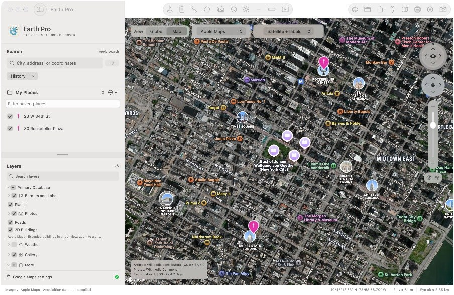

# Earth Pro for Mac

**Keep your globe on the desktop.**

Earth Pro is a **free, open-source native Swift Mac app**, with no app subscription, in-app purchases, or Earth Pro account. Explore a globe, plot address lists, measure distance and land, and work with portable KML projects and styled shapefiles. Start with free map providers; add your own Google Maps API key when you want supported Google imagery and photorealistic 3D.

Google has announced that new Google Earth Pro desktop downloads end **June 25, 2027**; existing installations can continue working. Earth Pro is an independent Mac alternative for keeping a desktop mapping workflow with supported KML/KMZ projects, measurements, custom pins, and image overlays. See [Google’s announcement](https://support.google.com/earth/thread/448773864). Earth Pro is not affiliated with Google and does not reproduce every Google Earth feature.

[Download for Mac](https://github.com/batbox55/earth-pro/releases/latest) · [Website](https://zachenson.com/earth-pro/) · [Support](https://zachenson.com/earth-pro/support) · [Privacy](https://zachenson.com/earth-pro/privacy)



*Actual app interface. Apple Maps imagery and third-party content retain their attribution and terms.*

## From an address list to a useful map

- **Plot up to 250 addresses at once.** Paste one address per line, review matches and unresolved entries, and frame the results together. Duplicate lines are skipped.
- **Make places recognizable.** Choose placemark colors, pin/circle/square/diamond shapes, icons, and notes. Search suggestions help find an address; selecting one zooms to a highlighted pin.
- **Work with KML projects.** Import KML and KMZ; create placemarks, paths, and polygons; export KML for other mapping tools.
- **Measure with precision.** Select distance, perimeter, and area units and decimal precision. Inspect coordinates, approximate elevation, and camera altitude.
- **Add context.** Search geographic layers, compare NASA and Esri Wayback imagery with supplied capture dates, and position local image overlays with adjustable bounds, opacity, and rotation.
- **Import styled vector layers.** Import a shapefile ZIP or folder with matching SHP, DBF and PRJ files, or GeoJSON/KML/KMZ. Shapefile and GeoJSON polygons retain holes and multipart geometry. Supported ArcGIS simple/category/class-break renderers, GeoJSON simplestyle and QGIS simple QML styles supply colors and legends; unsupported styles use a labeled fallback. Fully transparent publisher styles receive visible generated colors, and FEMA hatch symbols keep publisher colors and categories with a disclosed solid-fill approximation. Utility legends use matching line swatches. Common WGS84/NAD83/ETRS89, Web Mercator, UTM/Transverse Mercator, Lambert Conformal Conic and Albers projections are supported; unsupported datums/projections require export to EPSG:4326. NAD83/ETRS89 conversion is approximate, not survey-grade. Shapefile bundles are limited to 64 MB; custom layers retain the 300-part/16,000-vertex budget and report partial imports.
- **Organize and discover data.** Use Places, Layers, and Data tabs, folders, public parcels/zoning/flood layers, utility categories, and supported custom imports/connections. Data → Workbook layers & sources searches the v4 catalog of zoning/general plans, utilities, city layers, broadband, and national sources. Compatible vectors can be added; service roots offer a layer chooser, and other entries remain source links. Catalog browsing is metadata-only and lazy; source update dates are shown when supplied, separately from workbook dates. Coverage and reuse terms vary.
- **Capture a view.** Save map images and record silent map videos.
- **Browse data libraries by task.** Data → Data libraries groups the 31 v5 providers into local data, imagery, historical maps, and reference sources. Nine provider entries have live search adapters (ArcGIS, STAC, OpenAerialMap, Socrata and OpenDataSoft); 22 are reference/manual setup sources. The MCP `data_libraries` tool supports `list`, `collections`, `search`, `layers` and `add_result`. Search returns expiring IDs and access/source-date details. ArcGIS results connect through numbered layers; Socrata/OpenDataSoft vectors retain the area used by the search. STAC/OpenAerialMap additions are clearly labeled scene footprints, not displayed raster imagery. Source assets and terms remain available for inspection. Browsing never enables layers.
- **Connect a local AI client when you choose.** The local MCP server supports navigation, search, styled places, address-list jobs, notes, public and custom data, source dates, overlays, and video. It starts enabled, can be switched off, is loopback-only, and is protected by a session token. Use the toolbar's Local MCP panel to copy current connection instructions; keep the token private.

## Map providers and requirements

Requires **macOS 14 or later**. Online maps, address lookup, and live data need internet access. The globe, Apple Maps, and OpenStreetMap do not require a Google key. Google Maps and Google photorealistic 3D need your own compatible key and enabled APIs; Google may charge separately. Your key is stored in macOS Keychain.

Provider coverage, search matches, 3D detail, and elevation accuracy vary. NASA history is a daily satellite archive, not historical street-level aerial imagery. Earth Pro is independently developed and is not affiliated with Google. Provider data and imagery remain subject to their own licenses and service terms.

No Earth Pro account is required. Projects and preferences are stored locally. Network requests go directly to the services used by the selected feature; see the [privacy policy](https://zachenson.com/earth-pro/privacy).

## Build and run

Install Xcode (with command-line tools). From this repository:

```sh
swift build
./script/build_and_run.sh --verify
```

The script creates a locally signed development app in `~/Library/Caches/EarthPro/BuildProducts/Earth Pro.app`. This is a development build, not a notarized distribution artifact.

For the Xcode application target, install [XcodeGen](https://github.com/yonaskolb/XcodeGen), then:

```sh
xcodegen generate
open EarthPro.xcodeproj
```

Select your own development team before signing. `project.yml` is authoritative. The included bundle identifier and export team settings identify the original project; change them for your own distribution.

Run the existing tests:

```sh
./script/test.sh
```

## License and commercial-use limits

Original application source and original app artwork are licensed under the **MIT License**. See [LICENSE](LICENSE). Bundled datasets, terrain data, imagery, provider services, and third-party names are **not relicensed by MIT**. See [THIRD_PARTY_NOTICES.md](THIRD_PARTY_NOTICES.md), the resource attribution files, and each provider's terms.

**The distributed app’s included data/service configuration is not cleared for commercial use as-is.** Its Open-Meteo free elevation endpoint is noncommercial-only. Commercial deployments must replace or properly license restricted services and check every enabled dataset, imagery source, export, and recording against its provider terms. This does not restrict commercial rights to the MIT-licensed code. Some bundled sources are public domain; do not assume all sources prohibit commercial use. See the [full usage notice](Sources/EarthPro/Resources/License-Notice.txt).

Bug reports and focused contributions are welcome through GitHub issues and pull requests. Please omit API keys, MCP tokens, private addresses, and personal map files from reports.
